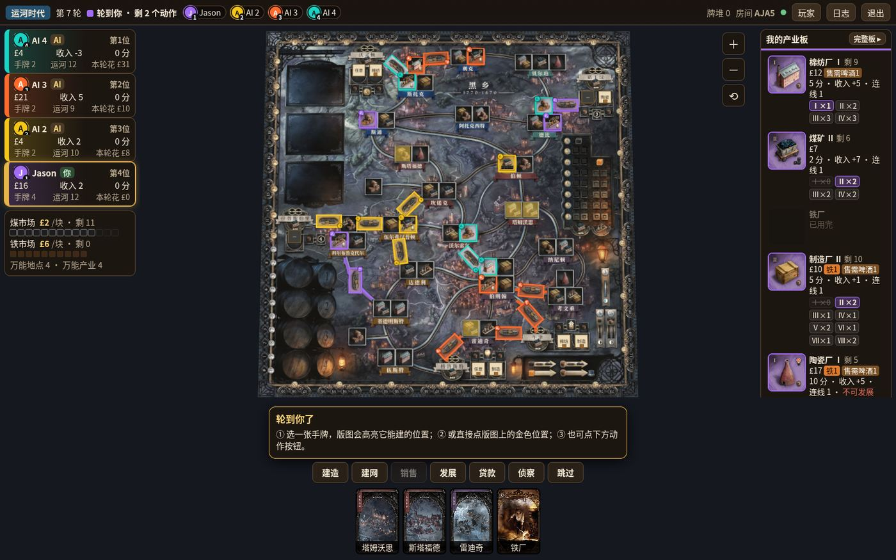
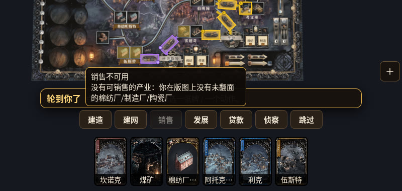
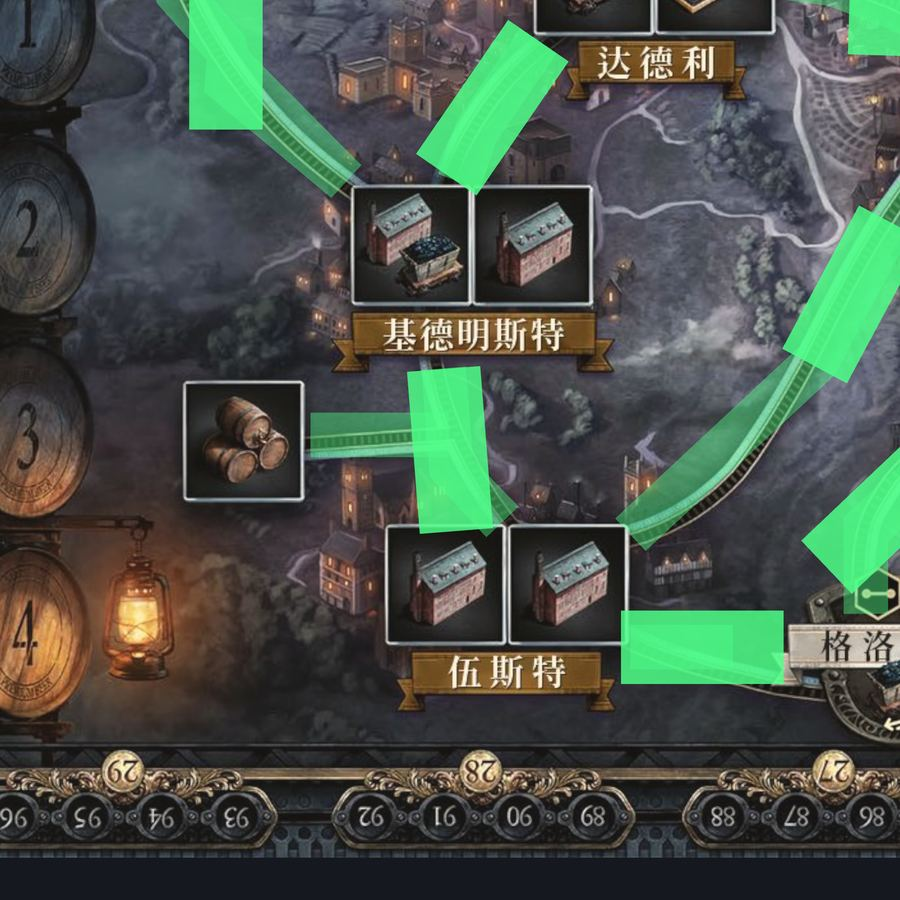
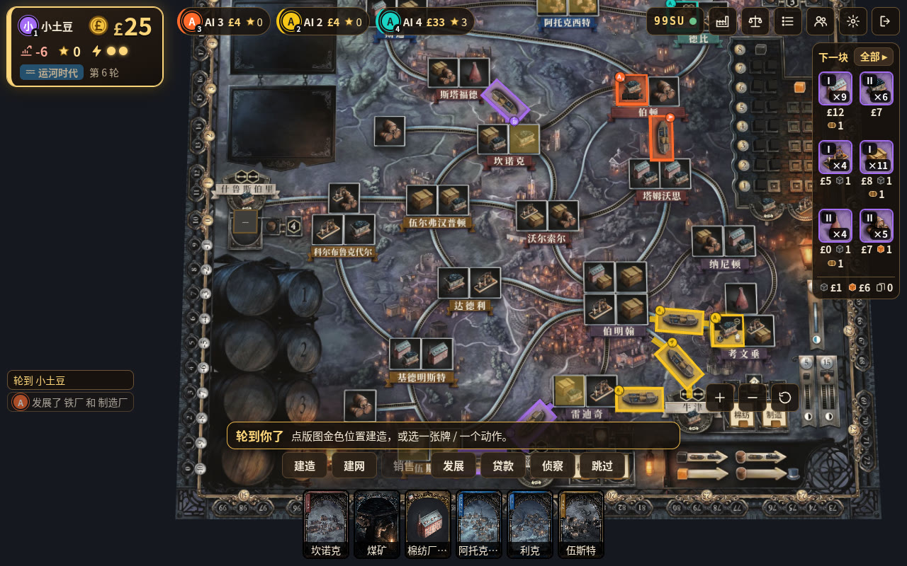
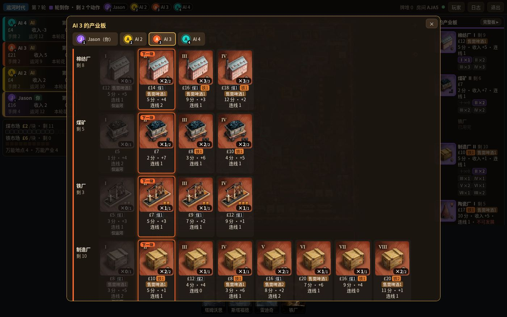
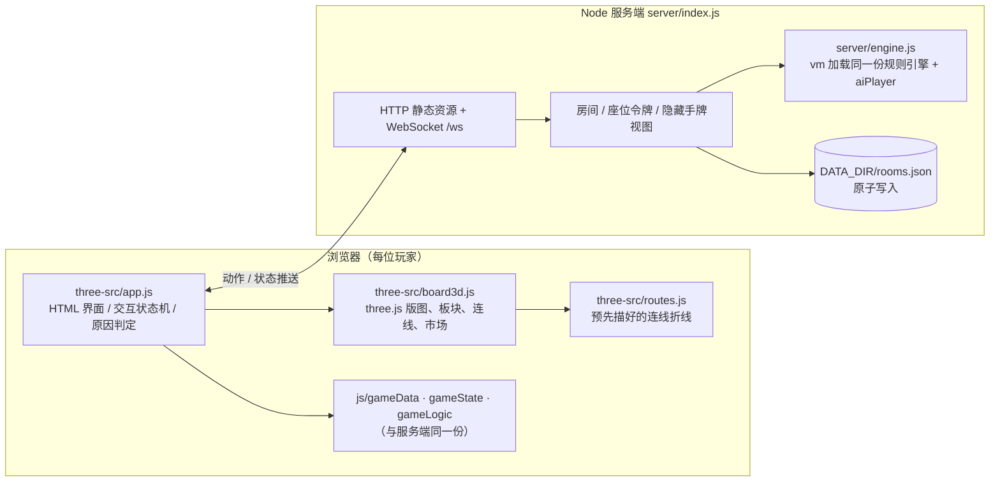

# 3D 版联机伯明翰

**Brass: Birmingham 3D Online** —— 用 three.js 重写的《工业革命：伯明翰》网页联机版（非官方粉丝作品）

> 📌 你现在看的是 `main` 分支：这里是经典 2D 联机中文版的代码（28788 端口运行的就是它）。**3D 版代码在 [`three` 分支](https://github.com/potatoyz/brass-birmingham/tree/three)**，下文的目录结构、3D 构建与测试都以 `three` 分支为准。

- 🌿 **代码分支**：3D 版的全部代码在 [`three` 分支](https://github.com/potatoyz/brass-birmingham/tree/three)；`main` 分支是联机 + 中文化后的经典 2D 版。

本项目 fork 自 [npow/brass-birmingham](https://github.com/npow/brass-birmingham)（单机同屏的 2D 网页版）。在保留它的规则引擎的前提下，加了服务端联机房间，做了全量简体中文化，并重写了一套 3D 前端。3D 前端专门针对“看清版图、点得准、知道为什么不能点”这几个实际痛点设计。

<p align="center">
  
  <br><em>4 人局：四色板块与连线、顶栏图例、左侧玩家卡、右侧“我的产业板”</em>
</p>

---

## 目录

- [创新点](#创新点)
- [与上游 npow/brass-birmingham 的对比](#与上游-npowbrass-birmingham-的对比)
- [技术架构](#技术架构)
- [目录结构](#目录结构)
- [本地运行](#本地运行)
- [部署](#部署)
- [测试](#测试)
- [更多截图](#更多截图)
- [致谢与版权](#致谢与版权)

---

## 创新点

下面每一条都写了：解决什么问题、怎么做的、代码在哪里。

### 1. three.js 3D 版图 + 受限俯视镜头 + HTML 文字层

**问题**：原版是一张 SVG 平面图，缩放后板块、方块挤在一起，层级容易错乱（卡牌、板块互相遮挡）。但如果随便做成能自由旋转的 3D，桌游又会变得难读、难点。

**做法**（`three-src/board3d.js`）：
- 把印刷版图（2048×2048）贴在一块有厚度的 3D 桌面上。板块、连线、资源方块、啤酒桶、商人板块都是真实的 3D 物体，有阴影、有高度，所以叠放层级是天然正确的。
- 镜头用 OrbitControls，但加了限制：最大倾角约 35°，水平旋转限制在约 ±46°，拖动范围被夹在版图之内，并且以鼠标位置为中心缩放。左键平移、右键旋转、滚轮缩放；手机上单指平移，双指缩放/旋转。这样有立体感，但永远不会“转丢”，随时可以一键复位。
- 所有文字（玩家卡、面板、提示、日志、手牌名）都是浮在画布上的 HTML，而不是画进 3D 里。中文清晰、可选中，并跟随浏览器缩放。
- 按需渲染：只有状态或镜头变化时才重绘（`dirty` 标记），静止时不占 GPU。
- three.js 按需 tree-shaking，用 esbuild 打成一个约 600KB 的 `js/three/bb3d.min.js`，没有运行时框架。

### 2. “先点再确认”的交互，取代组合下拉列表

**问题**：原版建造/建网要先选动作，再在弹窗列表里从“地点 × 产业 × 手牌”的组合里挑，然后再选弃牌。步骤多，而且看不到位置在版图哪里。

**做法**（`three-src/app.js`）：
- **两种顺序都支持**：先选一张手牌，版图会高亮它能建的位置；或者先点版图上的金色位置，再从能用的手牌里选。端到端测试分别统计了 `build:card→slot` 和 `build:slot→card` 两条路径。
- 每一步都把可选目标直接高亮在 3D 版图上（位置、连线、己方可卖产业等）。底部面板列出本次的费用明细（钱、煤/铁来源与价格），最后点“确认”才提交，中途可以取消。
- 建网、双铁路、销售（逐桶选啤酒）、发展（选 1–2 块）、侦察都走同一套“点选 → 面板汇总 → 确认”流程。

### 3. 灰按钮会说出“为什么不能点”，原因来自规则引擎

**问题**：按钮变灰但不知道原因，新手会卡住。上游虽然有 `getDisabledReason`，但只给笼统的提示，个别情况还不准，比如发展其实是缺钱，却提示“没有可发展的板块”。

**做法**（`App.whyNot`）：
- 用规则引擎把这个动作重新判定一遍，再把阻碍条件逐项拆开。例如临时假设钱足够，看能不能做，以此判断是不是“钱”卡住了；临时去掉煤/铁需求，判断是不是缺资源。
- 给出带具体数字的原因，比如“资金不足：建网需要 £3，你只有 £2”“没有可销售的产业：你在版图上没有未翻面的棉纺厂/制造厂/陶瓷厂”。
- 按钮不再用 `disabled` 属性（因为它会吞掉悬停事件），而是用样式置灰。悬停或长按显示原因，点一下也会弹出提示。
- 当只剩贷款、侦察、跳过可用时，提示栏直接写“现在只能贷款、侦察、跳过”，并逐条列出其他动作为什么不行。

<p align="center"></p>

### 4. 沿印刷线路自动描出的连线（含农场酿酒厂支线）

**问题**：早先连线高亮只是两城之间的直线，和版图上弯曲的铁路/运河对不上。带农场酿酒厂的连线（如基德明斯特—伍斯特，规则上是同一条连线、同时连通南边的农场）被画成两段，看起来像两条线，还像是指向农场。

**做法**（`scripts/trace-routes.py` → 生成 `three-src/routes.js`）：
- 在版图图像上做最短路径搜索（Dijkstra，1024 网格）。代价函数同时偏好运河的蓝色边缘和铁路的深色枕木，从而沿印刷线路走；再用 RDP 算法把路径简化成折线。
- 农场支线单独从农场寻路接到主线上，和主线画成同一条高亮。连线标记放在主线上避开障碍的位置，并顺着线路方向摆放。
- 只有 1 条线（科尔布鲁克代尔—基德明斯特）需要人工路径点（`scripts/route-overrides.json`）。
- 共 39 条连线。悬停提示写作“基德明斯特 — 伍斯特（经农场酿酒厂）”。

<p align="center"></p>

### 5. 四色玩家资产 + 归属一眼可辨 + 聚焦某个玩家

**问题**：上游的板块素材是一套混色的单套图，看不出板块是谁的。4 人局里尤其难分。

**做法**：
- 玩家 1–4 分别使用紫、黄、橙、青四套完整的板块和船/火车图（每色 60 张，共 240 张，`assets/tiles/<颜色>/`）。
- 每个板块和连线标记都有加粗的玩家色边框、同色底座光晕，以及角标徽章（名字首字母 + 座位号）；连线下面垫一条玩家色色带。所以不只靠颜色区分，色弱也能分清，翻面后仍然可见。
- 青色板块在屏幕上偏灰，所以它的主题色用了鲜艳的青色来区分。
- 顶栏图例和玩家卡与板块同色。悬停某个玩家时，只亮显他的产业和连线，其他人的淡化；点图例可以锁定。

<p align="center"></p>

### 6. 完整的玩家产业板（自己和对手的都能看）

**问题**：原来只显示每种产业的“下一块”，看不到后面还有什么，也看不到对手还剩什么。

**做法**：
- 右侧“我的产业板”每种产业一行，用 14px 文字直接写出费用、煤/铁、销售需啤酒数、分数、收入、连线分，以及每个等级还剩几块。下一块可建的等级高亮，用完的划掉。
- 点“完整板 ▸”或任意玩家卡，可以打开完整产业板：按产业和等级排开该玩家颜色的全部正面图，标出“下一块”、剩余/总数、仅运河/仅铁路、不可发展，用完的变灰。可以切换查看对手的板。

<p align="center"></p>

### 7. 市场与资源实物化

煤炭市场和铁市场按当前数量，把黑色煤块和橙色铁块放进印刷的价格格子里（格子坐标从版图上测得），便宜的格子先空。已建的煤矿/铁厂上放着剩余的煤/铁块，酿酒厂和商人处放啤酒桶。这些都随状态实时更新。

### 8. 悬停 / 长按看大图

手牌、产业板、版图上的已建板块，桌面端悬停、手机端长按（约 0.4 秒）都会弹出大图和中文说明，包括费用、产出、翻面得分、收入、连线分、适用时代。

### 9. 全量简体中文化（含图片），兼容旧存档

- 界面、日志、提示、计分全部是中文。版图 `board.jpg`、卡牌、玩家板图片里的英文也重绘成了中文。
- 内部 id、协议字段、存档 key 一律不变。手牌名由 id 推导，旧房间里的英文日志和计分标题会在客户端映射成中文，所以升级前创建的房间可以继续玩。

### 10. 服务端权威的联机房间

- 4 位房间号 + 邀请链接，大厅可以选 2–4 人，空位可以放 AI（简单/普通/困难）。
- **服务端权威**：所有动作都在 Node 服务器上用同一份规则引擎校验并执行，非法操作会被拒绝且不改动状态；AI 也在服务端跑。
- **隐藏信息**：每个客户端只收到自己的手牌。
- **断线重连**：浏览器在 localStorage 里保存座位令牌，刷新或断网后回到原座位。房主可以把掉线玩家的座位交给 AI 代打，玩家回来后点“收回控制”就能拿回来。
- **持久化**：房间原子写入 `DATA_DIR/rooms.json`，服务重启后对局恢复；7 天没有活动的房间会自动清理。
- 修复了上游销售的两个问题：一是可以逐桶选择啤酒来源；二是一次卖多个产业时整批校验，避免后面的产业被静默跳过，甚至出现“喝了商人啤酒拿了奖励、产业却没卖出”的情况。

### 11. 规则与客户端共用同一份引擎

`js/gameData.js / gameState.js / gameLogic.js / aiPlayer.js` 在浏览器里直接用 `<script>` 加载，在服务端由 `server/engine.js` 用 Node `vm` 加载同一份文件。3D 前端的高亮、可选目标、灰按钮原因，和服务端的最终校验，用的是同一套判定，不会出现“前端能点、服务器拒绝”这类两套规则不一致的问题。3D 前端只负责呈现和选择，不重新实现规则。

### 12. 双浏览器点击整局的端到端测试

`test/three-play.mjs` 启动两个真实的 Chrome，只通过点击 3D 界面（手牌、版图位置、连线、按钮），从开局一直打到游戏结束，覆盖建造（两种顺序）、建网、双铁路、销售、发展、贷款、侦察、跳过、商人奖励。每一步都检查服务器是否接受、两端状态是否同步，失败时自动截图。这个测试真的抓到过规则 bug：双铁路的第二条线选项没有扣掉第一条线用掉的煤、也没检查 £15 加两份煤的总价，现已在引擎里修复。

### 13. 低配模式与手机触屏

- 低配模式：`?low=1`，或 CPU 核数不超过 2 时自动启用。关闭阴影和抗锯齿，像素比固定为 1，降低各向异性过滤。
- 手机：窄屏下侧栏改为可展开的抽屉，手牌和按钮放大，支持单指平移、双指缩放、长按看详情。`test/three-mobile.mjs` 以 390×844 触屏视口跑一遍建造流程，并检查没有控制台错误。

---

## 与上游 npow/brass-birmingham 的对比

| 方面 | 上游 npow/brass-birmingham | 本项目（3D 版联机伯明翰） |
|---|---|---|
| 游玩方式 | 单机同屏轮流 | 多设备联机房间（保留同屏模式，在经典版中） |
| 规则执行 | 浏览器本地 | 服务端权威，同一份引擎前后端共用 |
| 版图 | 2D SVG 平面版图 | three.js 3D 桌面 + 受限俯视镜头（经典 2D 版仍保留） |
| 操作 | 选动作 → 弹窗组合列表 → 选弃牌 | 先牌后位置 / 先位置后牌，版图高亮 → 面板汇总 → 确认 |
| 不可用原因 | 笼统提示 | 规则引擎逐项判定，给出带数字的原因；“只能贷款/侦察/跳过”提示 |
| 连线显示 | 两城直线 | 沿印刷线路的折线，农场支线并入同一条 |
| 玩家区分 | 单套混色板块 | 四色板块 + 边框/底座/徽章/色带 + 图例 + 聚焦 |
| 产业板 | 只显示每种产业的下一块 | 完整产业板（全部等级与数字），可看对手 |
| 语言 | 英文 | 全量简体中文（含版图和卡牌图片），兼容旧存档 |
| 销售 | 啤酒自动分配；多产业逐个检查 | 逐桶选择啤酒；整批校验 |
| 测试 | — | 联机整局测试、销售场景测试、双浏览器 3D 点击整局测试、手机测试 |

---

## 技术架构



- 客户端发送的是“动作 + 参数”（如 `{action:'network', cardIndex, pendingData:{connectionId, connectionId2}}`）；服务器校验并执行后，按座位分别下发去掉他人手牌的状态。
- 构建只有一步：`npm run build:three`（esbuild），产物是 `js/three/bb3d.min.js`，已提交到仓库，部署时不需要构建。
- 连线折线由 `scripts/trace-routes.py`（Python + NumPy + Pillow）离线生成，运行时不做图像处理。

## 目录结构

（`three` 分支）

```
index.html                3D 版入口（加载规则引擎 + bb3d.min.js）
classic.html              经典 2D 界面（上游 UI + 联机/中文化改动）
three-src/
  app.js                  大厅、对局界面、点选确认流程、原因判定、产业板
  board3d.js              three.js 场景：版图、板块、连线、市场、高亮、镜头
  net.js                  WebSocket 客户端（重连）
  routes.js               生成的连线折线（勿手改）
js/
  gameData.js gameState.js gameLogic.js aiPlayer.js   规则引擎（前后端共用）
  three/bb3d.min.js       3D 前端打包产物
  online.js uiManager.js boardRenderer.js ...          经典 2D 版
css/three.css             3D 版样式
assets/
  board.jpg               中文版图
  cards/                  中文卡牌
  tiles/<kind>-<n>.jpg    经典版板块
  tiles/{purple,yellow,orange,teal}/   3D 版四色板块与船/火车
server/
  index.js                HTTP + WebSocket 房间服务器、持久化、AI 调度
  engine.js               在 Node 中加载规则引擎
scripts/
  build-three.sh          esbuild 打包
  trace-routes.py         沿印刷线路描连线
  route-overrides.json    个别连线的人工路径点
test/
  online-test.js          联机整局（3 真人 + 1 AI）
  sell-scenarios.js       销售/啤酒场景 + 全 AI 对局
  three-play.mjs          双浏览器 3D 点击整局
  three-mobile.mjs        手机触屏冒烟测试
docs/images/              README 截图
```

## 本地运行

需要 Node.js 18 及以上。

```bash
git clone -b three https://github.com/potatoyz/brass-birmingham.git
cd brass-birmingham
npm install
npm start                 # 默认 http://0.0.0.0:28788
# 打开 http://localhost:28788 进入 3D 版；/classic.html 为经典 2D 版
```

修改 `three-src/` 后需要重新打包：

```bash
npm run build:three       # 输出 js/three/bb3d.min.js
```

| 环境变量 | 默认值 | 说明 |
|---|---|---|
| `HOST` | `0.0.0.0` | 监听地址 |
| `PORT` | `28788` | 网页与 WebSocket（`/ws`）共用端口 |
| `DATA_DIR` | `./data` | 房间存档目录（`rooms.json`） |
| `AI_DELAY_MS` | `1100` | AI 每步之间的延迟（毫秒） |

URL 参数：`?room=CODE` 直接加入房间；`?low=1` 强制低配模式。健康检查：`GET /health`。

重新描连线（仅当版图图片变化时）：先把连线和锚点数据导出为 `/tmp/geo.json`，然后运行 `python3 scripts/trace-routes.py`，会重新生成 `three-src/routes.js`。

## 部署

服务是单进程 Node，用 systemd 托管即可。下面是示例，用户名和路径请自行替换：

```ini
[Unit]
Description=Brass Birmingham 3D online
After=network.target

[Service]
User=<服务用户>
WorkingDirectory=/opt/<app>/app
Environment=PORT=28789
Environment=DATA_DIR=/var/lib/<app>
ExecStart=/usr/bin/node server/index.js
Restart=always
NoNewPrivileges=true
ProtectSystem=full
ReadWritePaths=/var/lib/<app>

[Install]
WantedBy=multi-user.target
```

把 `index.html classic.html css js assets server package*.json` 复制到应用目录，执行 `npm install --omit=dev`，再 `systemctl enable --now`。更新前建议先备份旧文件；服务重启后房间会从 `rooms.json` 恢复。服务只提供 HTTP/WS，需要 HTTPS 时请在前面加反向代理，并转发 `/ws` 的 WebSocket。别忘了在防火墙/安全组放行端口。

## 测试

```bash
node test/online-test.js      # 起临时服务器：3 真人 + 1 AI 打完整局，检查隐藏手牌、同步、断线重连、重启恢复、非法操作、销售啤酒
node test/sell-scenarios.js   # 手工构造的销售场景 + 15 局全 AI 对局
```

3D 端到端测试需要 `puppeteer-core` 和本机 Chrome（脚本里默认路径 `/usr/bin/google-chrome`，截图目录可在脚本开头修改）。先启动一个服务器，再运行：

```bash
PORT=28790 DATA_DIR=/tmp/bb-test npm start &              # 测试用服务器
BASE=http://127.0.0.1:28790/ node test/three-play.mjs   # 两个浏览器只靠点击打完整局
node test/three-mobile.mjs                              # 390×844 触屏视口（服务器地址写在脚本开头的 BASE）
```

## 更多截图

| | |
|---|---|
|  |  |
|  |  |

## 致谢与版权

- 《Brass: Birmingham（工业革命：伯明翰）》由 Gavan Brown、Matt Tolman、Martin Wallace 设计，[Roxley Games](https://roxley.com) 出版。游戏设计与全部美术（版图、卡牌、板块等）的版权归 Roxley Games 及相关作者所有。喜欢的话请购买实体版支持原作。
- 基础代码来自 [npow/brass-birmingham](https://github.com/npow/brass-birmingham)，作者 Nissan Pow。
- 四色板块与船/火车素材来自 Tabletop Simulator 模组 [ikegami/tts_brass](https://github.com/ikegami/tts_brass)，图片从该模组引用的 Steam CDN 地址下载。
- 版图与卡牌的中文化版本，是在原美术基础上替换文字后制作的。
- 本项目是非官方粉丝作品，仅供非商业的学习与交流，不得用于商业用途。
- **代码许可**：上游仓库和本仓库目前都没有附带 LICENSE 文件，所以代码没有授予任何开源许可，版权归各自作者所有。如需复用，请先联系相应作者。
