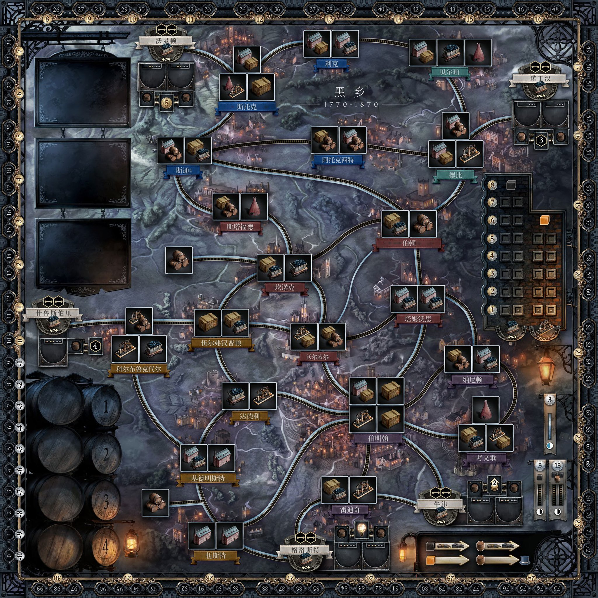

# Brass: Birmingham

[](https://mintlify.com/npow/brass-birmingham)

A digital adaptation of the award-winning board game by Roxley Games. Build your industrial empire across the English Midlands during the height of the Industrial Revolution (1770-1870).

> **Note:** This is an unofficial fan project. [Brass: Birmingham](https://roxley.com/products/brass-birmingham) is designed by Gavan Brown, Matt Tolman, and Martin Wallace, published by Roxley Games. Please support the original by purchasing the physical game.

## 联机版说明（本 fork 的改动） / Online fork

> 本仓库 fork 自 [npow/brass-birmingham](https://github.com/npow/brass-birmingham)，在原版"同屏轮流"玩法之外加入了**多人多设备联机房间**，并修复了原版**卖货（Sell）啤酒**相关的两个规则问题。原版内容、致谢与"非官方粉丝作品"声明见下文，保持不变。

### 联机房间

- **开房 / 加入**：首页填昵称 →「创建房间」得到 4 位房间号和邀请链接（`?room=CODE`）；朋友打开链接或输入房间号即可入座。
- **大厅**：房主选择 2–4 人，空位可设为 AI（简单 / 普通 / 困难），也可移出玩家；人齐后房主开始游戏。
- **服务端权威**：所有动作在服务器上用原版规则引擎（`gameState` / `gameLogic` / `aiPlayer`）校验并执行，非法操作被拒绝且不改动状态；AI 也在服务端运行。
- **隐藏信息**：每个客户端只收到自己的手牌，他人手牌和牌堆内容不会下发。
- **实时同步 + 断线重连**：WebSocket 实时推送；浏览器用 localStorage 里的令牌，刷新或断网后回到原座位。房主可把掉线玩家的座位交给 AI，之后再还给真人。
- **持久化**：房间保存在 `DATA_DIR/rooms.json`（原子写入），服务重启后对局恢复；超过 7 天无活动的房间自动清理。
- **同屏模式保留**：首页展开「本机同屏模式」即为原版玩法；直接用 `file://` 打开也仍是原版单机模式。

### 卖货 / 啤酒修复（原版就存在的问题）

1. **可以逐桶选择啤酒**：原版卖货窗口只有"是否用商人啤酒"一个勾选框，酿酒厂啤酒总是自动按"先自己、后对手"的顺序取，玩家无法选择（例如想用相连对手的啤酒保住自己的）。现在每桶啤酒都有下拉框可选：自己的酿酒厂（无需相连）、相连的对手酿酒厂、或所卖商人的啤酒（每次出售最多 1 桶，获得该商人奖励），并显示剩余桶数；仍提供合理的默认选择。服务器会校验每桶来源是否合法。
2. **一次卖多个产业时整批校验**：原版只逐个检查产业"单独能不能卖"，执行时若前面的产业把啤酒用完，后面的会被静默跳过——行动照样算成功、牌照样弃掉，甚至会出现**喝了商人啤酒拿了奖励、产业却没卖出**的情况。现在执行前对整批做啤酒分配校验（自动选择时会搜索所有可行分配）；不可行就整批拒绝、不改动任何状态，并给出清楚的提示。AI 也只提交能付得起的批次。

### 运行

需要 Node.js 18+。

```bash
npm install
npm start          # 默认 http://0.0.0.0:28788
```

环境变量：

| 变量 | 默认值 | 说明 |
|------|--------|------|
| `HOST` | `0.0.0.0` | 监听地址 |
| `PORT` | `28788` | 网页与 WebSocket（`/ws`）共用的端口 |
| `DATA_DIR` | `./data` | 房间存档目录（`rooms.json`） |
| `AI_DELAY_MS` | `1100` | AI 每步之间的延迟（毫秒） |

健康检查：`GET /health`。

### 部署（systemd 示例）

```ini
# /etc/systemd/system/brass.service
[Unit]
Description=Brass Birmingham online server
After=network.target

[Service]
User=brass
WorkingDirectory=/opt/brass/app
Environment=HOST=0.0.0.0
Environment=PORT=28788
Environment=DATA_DIR=/var/lib/brass
ExecStart=/usr/bin/node server/index.js
Restart=always
RestartSec=3
NoNewPrivileges=true
ProtectSystem=full
ReadWritePaths=/var/lib/brass

[Install]
WantedBy=multi-user.target
```

```bash
sudo useradd --system --no-create-home --shell /usr/sbin/nologin brass
sudo mkdir -p /opt/brass/app /var/lib/brass && sudo chown brass:brass /var/lib/brass
# 把 index.html css js assets server package*.json 复制到 /opt/brass/app，然后：
cd /opt/brass/app && sudo npm install --omit=dev
sudo systemctl daemon-reload && sudo systemctl enable --now brass
```

记得在防火墙 / 云安全组放行该端口。更新时可先把旧目录改名为 `app.prev` 以便回滚。

### 测试

```bash
node test/online-test.js      # 起一个临时服务器：3 真人 + 1 AI 打完整局，检查隐藏手牌、同步、断线重连、重启恢复、非法操作、卖货啤酒选择与整批校验
node test/sell-scenarios.js   # 手工构造的卖货场景 + 全 AI 对局；JS_DIR=<原版 js 目录> 可对比原版行为
```

`BASE_URL=http://host:port MODE=smoke node test/online-test.js` 可对已部署的服务器做冒烟测试。

### 已知限制

- 服务器只提供 HTTP / WS；需要 HTTPS 请自行在前面加反向代理（并转发 `/ws` 的 WebSocket）。
- 知道房间号的人都能进入观战（看不到任何人的手牌）。
- 手机上可以玩，但棋盘较小，主要按桌面浏览器设计。
- 新增界面为中文，原版游戏界面文字仍为英文。

**English summary:** this fork adds online multi-device rooms (4-letter room codes, lobby with AI seats, server-authoritative rules reusing the original engine, hidden hands, WebSocket sync with reconnect, JSON persistence, 7-day idle cleanup; hotseat mode kept) and fixes two upstream Sell bugs: beer can now be chosen per barrel (own brewery, connected opponent brewery, or the merchant's barrel), and multi-tile sales are validated as a whole batch up front — previously later tiles were silently skipped once beer ran out, sometimes after a merchant bonus had already been granted. Run with `npm install && npm start` (env `HOST`, `PORT`=28788, `DATA_DIR`=./data); tests: `node test/online-test.js`, `node test/sell-scenarios.js`.

---

## Screenshots

<p align="center">
  
  <br><em>A quick look at setup, the labeled card hand, both eras, building, and scoring.</em>
</p>

<p align="center">
  
  <br><em>Canal Era in play with the bundled board, cards, tile art, and resource cubes.</em>
</p>

<p align="center">
  
  <br><em>Rail Era, with a wider network and higher-level industries.</em>
</p>

<p align="center">
  
  <br><em>The printed board artwork used by the game.</em>
</p>

---

## The Game

Compete as rival entrepreneurs in Birmingham and its surrounding towns. Establish canals and railways, develop industries, and outmaneuver your opponents across two distinct eras.

**2-4 Players** · **Canal Era + Rail Era** · **Hotseat Multiplayer** · **Online Rooms (this fork)**

### Two Eras of Industry

**Canal Era (1770-1830)** — Build canals and establish your first industries. Only one tile per location. At the end, all canals and Level I tiles are removed — but Level II+ tiles carry over and score again.

**Rail Era (1830-1870)** — Build railways (requiring coal), expand aggressively with multiple tiles per location, and push for the highest score.

---

### Build Your Empire

Choose from six industry types, each with a unique strategic role:

| Industry | Role | Key Trait |
|----------|------|-----------|
| **Cotton Mills** | Sell goods for VP | Expensive but high-scoring |
| **Coal Mines** | Fuel rail links and industries | Cheap, strong income |
| **Iron Works** | Supply iron for building and development | Efficient, denies opponents |
| **Manufacturers** | 8 unique levels with varied rewards | Versatile and complex |
| **Potteries** | Massive VP potential (up to 20 VP) | High cost, requires planning |
| **Breweries** | Supply beer for selling goods | The most important industry |

Select what to build, where, and for how much — all costs including coal and iron sourcing are calculated automatically.


<p align="center"><em>Build action — choose from available industries at locations matching your cards</em></p>


<p align="center"><em>Sell action — check the goods, beer requirement, and merchant bonus before selling.</em></p>

---

### Clear Action Workflow

A persistent **action phase bar** guides you through each turn:

1. **Choose Action** — Pick from Build, Network, Develop, Sell, Loan, Scout, or Pass
2. **Select Target** — Choose what/where to build, which connection, etc.
3. **Discard Card** — Valid cards glow gold; invalid cards are dimmed

The phase bar shows your current step, contextual instructions, and a cancel button. Press **Escape** at any time to abort.

When waiting for card selection, action buttons and your player mat dim to focus attention on your hand. Only valid discard options are clickable.

---

### Game Log & Turn Transitions

A **scrollable game log** in the right panel records every action: builds, network links, sales, loans, and more — color-coded by player. No more relying on fleeting toast notifications.

Between turns, a **brief animated overlay** shows the next player's name in their color, giving a clear visual break.


<p align="center"><em>Right panel — player stats, markets with current prices, and the game log</em></p>

---

### Develop to Unlock Higher Tiers

Spend iron to remove low-level tiles from your player mat and access the powerful high-level industries underneath. Optionally develop two tiles at once.


<p align="center"><em>Develop action — skip past weak tiles to access Level III+ industries</em></p>

---

### Your Hand, Your Strategy

Play location cards to build anywhere on the map, or industry cards to build within your network. Manage your hand carefully — every action costs a card.

Cards use the included printed faces, with inline SVG artwork as a fallback.


<p align="center"><em>Bottom panel — your hand of cards, the seven available actions, and your remaining industry tiles</em></p>

---

### The Board

The game includes the printed board artwork and also has an original, procedural
night-time relief map as a fallback:

- **Procedural terrain** — a hill-shaded elevation raster generated in-page, with an industrial haze over the Black Country basin
- **Region washes** tinting each county, and warm furnace light pooling over every town
- **Towns on slate plinths** with region-coloured name ribbons, as printed on the board
- **Engraved industry art** — a spinning mill, pithead winding gear, blast furnace, sawtooth workshop, bottle kiln and cask, rather than abstract glyphs
- **Canals** as cut waterways and **railways** as ballast with sleeper ties; rivers stay desaturated so they never read as buildable links
- **A numbered 0–99 score track** running the perimeter of a brass frame

Slots permitting two industries show both icons split on the diagonal.

---

### Bundled Board Artwork

The repository includes the board, industry chips, card faces, and player mat
under `assets/`. The README gallery above shows the board art in play and as a
full map.

To use a different board image, replace `assets/board.jpg` locally or point the
browser at another image:

```js
localStorage.brassBoardAsset = 'https://example.com/board.jpg'
```

The matching chip, card and mat files are already included:

```
assets/board.jpg              the map
assets/tiles/<kind>-<n>.jpg   industry chips, e.g. coal-1.jpg, iron-3-flipped.jpg
assets/cards/<id>.jpg         card faces, keyed by city id or industry id
assets/player-mat.jpg         the player mat
```

The printed map carries the towns, routes and merchant buildings, and the game
draws the changing state on top: placed chips, resource cubes, beer barrels and
highlights. The locally bundled assets are tracked with the project; browser
overrides and calibration remain in local storage.

All 27 locations move to measured positions for a retail board, and each
location's industry spaces are placed using the arrangement the board actually
prints — Coalbrookdale one space over two, Birmingham two over two, and so on,
rather than a single row. To adjust the alignment, open the page with
`?calibrate=1`:

| Input | Effect |
|-------|--------|
| drag a town / merchant / brewery | move it onto its printed space |
| `c` | dump the finished layout as JSON to the console |
| `r` | reset to the measured defaults |

Positions are stored normalised, so one calibration holds for any image at any
resolution, and is saved automatically as you drag.

> Board artwork is normally the publisher's copyright. Supplying an image is
> your call — use art you have the right to use.

### Era Scoring

At the end of each era, score VP from your flipped industry tiles and the links connecting them. Higher-level tiles placed in the Canal Era score in *both* eras.


<p align="center"><em>Era scoring — link VP and industry VP tallied for each player</em></p>

---

## How to Play

### Quick Start

```
python3 -m http.server 8080
```

Open [http://localhost:8080](http://localhost:8080) in your browser. No build step or dependencies.

1. Choose 2-4 players and enter names
2. Click **Begin Game**


### On Your Turn

1. **Select an action** from the action panel (Build, Network, Develop, Sell, Loan, Scout, or Pass)
2. **Follow the phase bar** — it shows your current step and what to do next
3. **Choose your target** from the modal or board
4. **Click a valid card** (highlighted with a gold pulse) to discard

Disabled action buttons show **tooltips explaining why** they can't be used (e.g. "No iron available", "Need at least 3 cards").

The game handles all resource sourcing (coal, iron, beer), market pricing, turn order, and scoring automatically.

### Tips for New Players

- **Build breweries early** — Beer is the most contested resource in the game
- **Watch the turn order** — Spending less money means going first next round
- **Develop to skip weak tiles** — Accessing Level III+ tiles is worth the iron cost
- **Build in the Canal Era for double scoring** — Level II+ tiles persist into the Rail Era
- **Don't ignore income** — It compounds every round and scores VP at the end

---

## Rules Reference

This implementation follows the official Brass: Birmingham rulebook:

- **Coal** requires a connected source (mine or market via merchant link)
- **Iron** can be taken from any iron works on the board — no connection needed
- **Beer** for selling comes from your own breweries (anywhere), connected opponent breweries, or merchant barrels
- **Overbuilding** your own tiles requires same type + higher level; opponent coal/iron tiles can only be overbuilt when that resource is globally depleted
- **Pottery I and III** have the lightbulb icon and cannot be developed — they must be built
- **Turn order** each round goes to whoever spent the least money

---

## Architecture

Pure HTML/CSS/JS — no build tools, no frameworks, no dependencies. Board and
component artwork is bundled under `assets/`; procedural board art remains the
fallback.

| File | Purpose |
|------|---------|
| `index.html` | Layout: setup screen, game screen with phase bar, game log, overlays |
| `css/style.css` | Dark Victorian theme with CSS animations, card-select mode, transitions |
| `js/gameData.js` | All constants: tiles, cities, connections, cards, merchants, markets |
| `js/gameState.js` | Game state, market mechanics, network pathfinding, turn management |
| `js/gameLogic.js` | All 7 actions + `getDisabledReason()` for tooltip feedback |
| `js/industryIcons.js` | Engraved industry illustrations shared by the board and hand cards |
| `js/boardAssets.js` | Bundled board/component artwork + measured board layout |
| `js/boardRenderer.js` | SVG board: procedural terrain, frame + score track, calibration mode |
| `js/uiManager.js` | Phase bar, card selection mode, game log, turn transitions, modals |
| `js/main.js` | Entry point, setup screen |
| `js/online.js` | (fork) Online client: rooms, lobby, reconnect |
| `css/online.css` | (fork) Styles for the online UI and beer picker |
| `server/index.js` | (fork) Node HTTP + WebSocket room server, persistence |
| `server/engine.js` | (fork) Loads the browser rules engine in Node, validates actions |
| `test/` | (fork) Online end-to-end test and sell/beer scenarios |

---

## Credits

- **Brass: Birmingham** designed by Gavan Brown, Matt Tolman, and Martin Wallace
- Published by [Roxley Games](https://roxley.com)
- Tile data verified against the [Tabletop Simulator](https://github.com/ikegami/tts_brass) implementation by Kini/ikegami
- Board geography and card data referenced from community implementations

---

*Fan-made digital adaptation for personal and educational use. All game design credit belongs to the original designers and publisher.*
